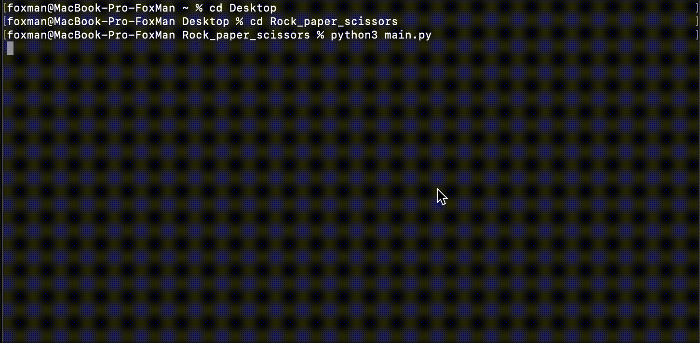

# Проект "Камень, ножницы, бумага"

## Описание проекта 
Реализация класической игры "Камень, ножницы, бумага" в которой участники это пользователь и компьютер. Особенность, что эта игра локальная и доступна без интернета.

## Цели проекта 
Реализовать игру, используя язык програмирования Python.

## Используемые технологии
Python для создания самой игры.

## Установка зависимостей
Загрузите на компьютер необходимые файлф ( скачайе репозиторий ).

## Пример запуска 
Для запуска у вас должен быть установлен Python3.
Для начала игры необходимо: перейти в папку с main.py. 
Затем записать:

```python
python3 main.py
```


Проект выполнен в образовательных целях на онлайн-курсе "Введение в програмирование на Python" онлайн-школы "Лидер".
